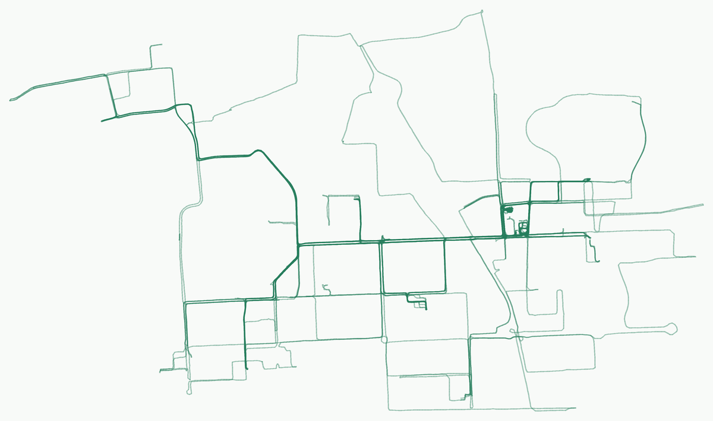

# Along · 九号骑行地图

把九号 App 里会过期的骑行记录，变成一份属于自己的长期骑行档案。

Along 是一个非官方的九号骑行数据归档与可视化工具。它可以增量采集骑行轨迹，在本机生成交互式地图和常去地点统计，按需导出标准化数据，并通过私有 GitHub Actions 定期同步。九号官方通常只保留最近 180 天的详细轨迹；这个项目关注的不是“再做一个骑行排行榜”，而是让已经发生过的路，过很久以后仍然看得见。

> 本项目与九号公司无隶属或合作关系。请使用自己的账号，并遵守服务条款、合理控制请求频率。



## 目录

- [功能](#功能)
- [工作原理](#工作原理)
- [快速开始](#快速开始)
- [常用命令](#常用命令)
- [云端自动同步](#云端自动同步)
- [隐私与安全](#隐私与安全)
- [常见问题](#常见问题)
- [项目结构](#项目结构)
- [参与开发](#参与开发)
- [来源与许可](#来源与许可)

## 功能

- **长期归档**：按月增量保存轨迹，重复采集不会覆盖已经成功发布的月份。
- **本地地图**：查看交互轨迹、约 200 米网格的经过次数、常去地点与骑行日统计。
- **地点管理**：给地点命名、合并同一地点，保存羽毛球活动与停车停留的派生统计。
- **自动同步**：由独立的私有 GitHub 仓库定时采集，本机无需常驻或后台运行。
- **公开分享**：默认只向公开仓库发布无底图轨迹图片；也可显式导出脱敏后的静态只读地图。
- **标准数据**：生成可校验、可迁移的 Ride Dataset v1，网站、统计和导出共用同一份数据契约。

## 工作原理

| 运行位置 | 负责内容 | 保存内容 |
| --- | --- | --- |
| 本机 | 登录、首次采集、下载档案、查看地图 | `.private/` 中的会话与 `data/` 中的骑行档案 |
| 私有 GitHub 仓库 | 定期执行采集，持久保存加密档案 | `state` 分支中的加密快照与 GitHub Secrets |
| 公开 GitHub 仓库 | 发布程序、文档和持续更新的轨迹图片 | 代码、文档与 `assets/ninebot-tracks.png` |

私有的同步仓库负责采集，公开仓库只负责展示。两者是不同仓库，公开仓库不保存账号会话、原始坐标 JSON 或完整骑行档案。

## 快速开始

### 环境要求

- Python 3.11 或更高版本（由 [uv](https://docs.astral.sh/uv/getting-started/installation/) 管理）
- Git
- OpenSSH（Windows 自带的 OpenSSH Client 即可）
- 使用云端同步时另需 [GitHub CLI](https://cli.github.com/)
- 仅运行自动验收时需要 Node.js 和 npm

安装脚本会根据 `uv.lock` 创建项目专用的 `.venv`，不修改系统 Python 环境。

### Windows 10 / 11

1. 安装 [uv](https://docs.astral.sh/uv/getting-started/installation/)。
2. 克隆仓库并进入项目目录：

```bat
git clone https://github.com/xmm50314/ninebot-map.git
cd /d ninebot-map
```

3. 双击 `start.cmd` 完成首次登录和采集，再双击 `run.cmd` 打开地图。

也可以在命令提示符中运行：

```bat
start.cmd
run.cmd
```

首次运行时，`start.cmd` 会自动调用安装脚本并创建 `.venv`。

### macOS / Linux

1. 安装 [uv](https://docs.astral.sh/uv/getting-started/installation/)。
2. 克隆仓库并进入项目目录：

```bash
git clone https://github.com/xmm50314/ninebot-map.git
cd ninebot-map
```

3. 执行首次采集并打开地图：

```bash
./start.command
./run map
```

### 首次采集

`start` 会依次要求：

1. 输入九号账号和密码。密码隐藏显示，不进入命令历史，也不会以明文保存。
2. 选择要归档的车辆。
3. 指定首次同步的起始月份。

首次采集完成后，后续打开地图无需再次登录九号。若想先检查本地环境，可运行 `./run doctor` 或 `run.cmd doctor`；该检查不会连接九号账号。

## 常用命令

以下以 macOS / Linux 为例，Windows 将 `./run` 替换为 `run.cmd`。

| 命令 | 用途 |
| --- | --- |
| `./run map` | 打开已选车辆或唯一档案的本地地图 |
| `./run start` | 首次登录、选车并采集 |
| `./run sync` | 增量采集本月数据 |
| `./run sync --from 202601 --to 202603` | 采集指定月份范围 |
| `./run prepare --all-map-tracks` | 重新生成包含全部轨迹的标准数据 |
| `./run validate <dataset.json>` | 离线校验标准数据 |
| `./run export-site --dataset <dataset.json> --output <目录>` | 导出脱敏的静态只读网站 |

地图默认打开 `http://127.0.0.1:8765/`。终端需要保持运行，按 `Ctrl-C` 关闭服务。端口被占用时会自动尝试 `8766–8775`，也可用 `./run map --port 8766` 指定。

## 云端自动同步

先用 GitHub CLI 登录：

```bash
gh auth login
```

完成首次本地采集后，可以创建私有同步仓库并启用 GitHub Actions：

```bash
./run cloud install
./run cloud status
./run cloud run
```

默认每 10 天同步一次；Actions 每天北京时间约 10:17 检查是否到期。常用管理命令如下：

```bash
./run cloud map                    # 下载最新档案并打开地图
./run cloud pull                   # 只下载最新档案
./run cloud run                    # 立即触发一次同步
./run cloud install --interval-days 7
./run cloud credentials            # 会话失效后更新 GitHub Secret
./run cloud disable                # 停用定时同步
```

如需让 GitHub Actions 同时更新公开仓库中的轨迹图片，可指定一个或两个公开目标：

```bash
./run cloud install --publish-repo <用户名>/<公开仓库名>
```

安装过程会自动创建名为 `<用户名>/ninebot-map-sync` 的私有仓库，并用项目生成的 SSH Deploy Key 只更新指定的公开图片文件。**不要把私有同步仓库改成公开。**

## 隐私与安全

- `.private/` 保存本机会话、车辆偏好和可选发布密钥。
- `data/` 保存原始骑行档案；`work/` 保存临时处理和验收证据。
- 以上目录均被 `.gitignore` 排除，默认不会进入公开 Git 仓库。
- 九号密码不会上传；云端使用 GitHub Secrets 保存登录会话和发布凭据。
- 骑行档案在 `state` 分支中以加密快照保存，解密密钥只在本机 `.private/`。
- 默认公开分享内容只有无底图轨迹图片。完整展示数据只有在用户显式配置静态网站发布后才会发送到指定接收器。
- 打开 OpenStreetMap 底图时，瓦片提供方可以知道请求的大致网络位置和视野；轨迹点本身不会随瓦片请求发送。

如果发现安全问题，请不要在公开 Issue 中粘贴账号、Cookie、Token、密码、原始轨迹或密钥。先撤销相关凭据，再用脱敏后的信息描述问题。

## 项目结构

```text
nbmap/          Python 采集、归档、地图服务与公开数据
web/            本地地图前端及固定版本的浏览器依赖
scripts/        安装、导出、打包与验收脚本
tests/          Python 单元测试和浏览器合成测试
docs/           运行、地图、数据格式与部署文档
schemas/        Ride Dataset v1 JSON Schema
examples/       可公开的合成示例数据
templates/      GitHub Actions 与静态站点服务模板
```

## 参与开发

安装开发依赖并运行完整合成验收：

```bash
npm ci
npm run verify
```

只验证地图：

```bash
npm run verify -- --suite map
```

Python 测试：

```bash
.venv/bin/python -m unittest discover -s tests -v
```

Windows 对应使用 `.venv\Scripts\python.exe -m unittest discover -s tests -v`。自动验收使用合成 fixture，不会登录九号或访问真实骑行档案。

## 常见问题

**数据保存在哪里？**

登录会话和本机配置位于 `.private/`，原始骑行档案位于 `data/`。这两个目录都已被 `.gitignore` 排除，不会被普通 `git push` 上传。

**必须一直开着电脑吗？**

不需要。完成首次采集后，可以按“云端自动同步”配置私有 GitHub Actions，让 GitHub 定时采集；本机只在需要查看或下载最新档案时运行。

**公开仓库会暴露骑行轨迹吗？**

默认只发布无底图的轨迹图片，即本 README 顶部的图片。完整的静态地图需要你显式配置发布目标后才会生成和发送。请不要把私有同步仓库改成公开。

**以后怎么更新本地代码？**

先确认工作区没有未提交的重要改动，再运行：

```bash
git pull --ff-only
```

如果只想更新依赖而不重新采集，可以再运行 `./run doctor`（Windows 为 `run.cmd doctor`）。

**接口失效或登录失败怎么办？**

这是依赖非官方接口的项目，无法保证接口长期稳定。请先更新代码和依赖，并确认自己的账号、网络和会话状态；不要尝试绕过登录限制。公开提问时请删除账号、Cookie、Token、密钥和原始轨迹。

## 更多文档

- [文档索引](docs/README.md)
- [地图使用与统计口径](docs/map-viewer.md)
- [采集、存储与发布架构](docs/operations.md)
- [静态地图部署](docs/static-deployment.md)
- [数据格式与 JSON Schema](docs/data-format.md)
- [项目架构](docs/architecture.md)

## 来源与许可

本项目基于 [Timisic/ninebot-map](https://github.com/Timisic/ninebot-map) 的代码继续开发和整理，感谢原作者与所有贡献者。原项目及本项目均采用 [MIT License](LICENSE)；各第三方前端资源在 `web/vendor/` 中保留各自许可证。

Along 不提供九号账号交易、绕过登录或突破访问限制的功能，也不保证非官方接口长期稳定。请自行备份重要数据，并在使用前确认账户与数据处理的合规性。
